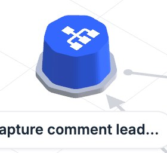
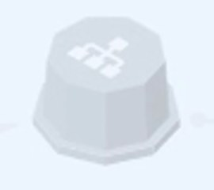
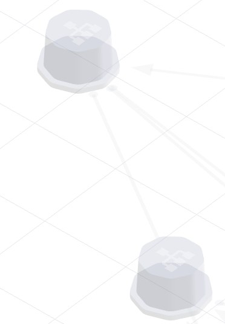
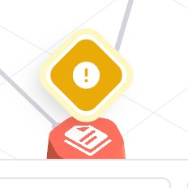

# Workflow Maps 3D map tokens: what the film must be re-rendered with

The 3D map in `public/footage/app-motion-v25.mp4` is pre-rendered, and its elements do not match the product. The video now
redraws every map shot over the film with the product's own geometry and materials (`src/video/map3d/`, see CLAUDE.md), so
the film itself no longer needs re-rendering. The values below come from the product's code (automation-workflows-frontend,
`src/components/workflow-grid/`) and were checked against staging; they are in
[`src/video/builder/mapTokens.ts`](../../src/video/builder/mapTokens.ts) and `src/video/map3d/geometry.ts`.

## Film vs product

| | Film (v25) | Product |
|---|---|---|
| Workflow node |  |  |
| Asset node |  |  |
| Dimmed node |  |  |
| Selected node | |  |
| Missing asset | |  |

What to change, most visible first:

1. **Workflow node colour and shading.** The film's body is a dull blue (`#547add` on top) with near-black sides
   (`#2a4da5`). The product's body is cobalt `#2455d6`, lit by an environment map and self-lit (emissive = its own colour × 0.35),
   so it reads bright: about `#3b7dff` on top and `#3666f4`–`#4484ff` on the sides.
2. **Node proportions.** The product's node is a short, wide plinth: a nonagon base (radius 0.396, height 0.06) under a
   body that tapers 6 % (radius 0.336, height 0.384), with 0.048 rounded corners. The film's body is taller and narrower,
   and its base ring is too thin.
3. **Base ring.** Published = green-500 `#22c55e`, draft = gray-400 `#9ca3af`. The film uses a darker teal-green.
4. **Selection.** The product's selected node glows: emissive ×1.1, an additive halo shell (×1.52 XZ, ×1.45 Y, opacity
   0.16) and a radial glow sprite (×1.65, opacity 0.4), lifted 0.12. There is no green ring and no outline.
5. **Dimmed nodes.** They fade to gray-400 at 0.3 opacity, so they look like frosted glass with the icon faintly visible
   (see the product crop). The film draws them as solid light-grey prisms.
6. **Asset nodes.** Rounded hexagon prisms, radius 0.3, height 0.2 (about half a workflow's height), in the type's
   hue-500 with a white icon on top. The film's assets are too tall and the wrong green (Products are emerald `#10b981`).
7. **Edges.** Flat ribbons on the ground in gray-300 `#d1d5db`, 0.036 wide, straight, with a 0.045 source dot and a
   0.2 × 0.18 arrowhead. A lit route turns blue-200 `#bfdbfe` with one blue-500 `#3b82f6` triangle pulse moving 0.35 of the edge
   per second. The film's lit edges are thicker and mid-blue.
8. **Folder planes.** 0.1-thick slabs with 0.3 corners. Default face white, sides blue-500, 0.01 gray-300 border. A
   coloured folder has a hue-50 face and hue-500 sides and border (palette below). The film's slabs are much thicker,
   with heavy coloured sides.

## Scene

| Token | Value |
|---|---|
| Renderer | WebGPU, antialias, pixel ratio ≤ 2, no tone mapping, no shadows, no fog, no post-processing |
| Lighting | no lights; image-based lighting from `public/env-map-3.hdr` (in the frontend repo), PMREM, `environmentRotation.y = π/2` |
| Camera | orthographic, 10 world units tall at zoom 1, direction (7, 9, 8) from the target (≈ 40.3° elevation, 41.2° yaw), up +Y |
| Background | `#ffffff` |
| Ground grid | 1-unit cells, 1 px `#e5e7eb` lines, at y = −0.15, no fade |

## Workflow node

| Token | Value |
|---|---|
| Base | nonagon, circumradius 0.396, height 0.06 |
| Body | nonagon, circumradius 0.336, height 0.384, top taper 6 %, sinks 0.004 into the base |
| Corners | rounded 0.048; one vertex points toward +Z |
| Colour | cobalt `#2455d6` |
| Base ring | published `#22c55e`, draft `#9ca3af` |
| Material | MeshStandard, metalness 0, roughness 0.45, emissive = colour × 0.35 (selected 1.1, dimmed 0.12, hover +0.14) |
| Icon | `mdi:sitemap`, white, 0.36 square on the top face |
| Hover | lift 0.12, XZ ×1.3, spring 0.6 s with bounce 0.2 |
| Dimmed | colour → `#9ca3af`, opacity 0.3, over 0.45 s |

## Asset node

Rounded hexagon prism: radius 0.3, height 0.2, corners 0.08, 6 % taper, a vertex toward ±Z, white 0.3 icon on top.
Link badge (an asset with copies in other folders): a 0.1-radius coin in the type's hue-800 with a white link icon,
floating 0.35 above the node.

| Type | Body (500) | Badge (800) | Icon |
|---|---|---|---|
| Tags | `#a855f7` | `#6b21a8` | heroicons-solid:tag |
| Forms | `#14b8a6` | `#115e59` | mdi:form-select |
| Calendars | `#0ea5e9` | `#075985` | heroicons-solid:calendar |
| Surveys | `#eab308` | `#854d0e` | mdi:clipboard-list |
| Pipelines | `#f59e0b` | `#92400e` | mdi:view-column |
| Funnels | `#f97316` | `#9a3412` | mdi:filter |
| Funnel pages | `#f45d48` | `#9b2b20` | mdi:file-document-multiple |
| Funnel products | `#e9a40b` | `#84460f` | mdi:package-variant-closed |
| Products | `#10b981` | `#065f46` | mdi:package-variant |
| Users | `#84cc16` | `#3f6212` | heroicons-solid:users |
| Videos | `#ef4444` | `#991b1b` | mdi:play-circle |

## Folder plane

| Token | Value |
|---|---|
| Slab | extruded rounded rectangle, 0.1 thick (top at y = 0), corner radius 0.3, unlit |
| Default | face `#ffffff`, sides `#3b82f6`, border `#d1d5db` 0.01 wide |
| Coloured | face hue-50, sides and border hue-500 |
| Nesting | +0.006 y per level; default faces tint toward `#e5e7eb` by 0.18 per level |
| Selected | lifts 0.15 (spring stiffness 180, damping 22) |
| Size | node bounds + 1.0 padding; planes packed 1.5 apart |

Palette (face / edge): yellow `#fefce8` / `#eab308`, blue `#eff6ff` / `#3b82f6`, green `#f0fdf4` / `#22c55e`,
orange `#fff7ed` / `#f97316`, cyan `#ecfeff` / `#06b6d4`, gray `#f9fafb` / `#6b7280`, teal `#f0fdfa` / `#14b8a6`,
purple `#faf5ff` / `#a855f7`, fuchsia `#fdf4ff` / `#d946ef`, rose `#fff1f2` / `#f43f5e`.

## Edges

| Token | Value |
|---|---|
| Causal (actions, triggers, hand-offs) | `#d1d5db`, 0.036 wide, solid |
| Reference | `#e5e7eb` at 0.75, 0.024 wide, dashed 0.16 / 0.1 |
| Hover / selected | `#bfdbfe` / `#3b82f6`, 0.06 wide, 0.2 s ease |
| Dimmed | opacity 0.18 |
| Markers | source dot 0.045; arrowhead 0.2 long, 0.18 wide |
| Lit route | line `#bfdbfe`, one `#3b82f6` triangle pulse (0.2 × 0.2) moving 0.35 of the edge per second |
| Height | ribbons at y = 0.066 |

## Labels, markers, notes

- **Labels:** screen-facing pills, white, 1 px `#e5e7eb` border, fully rounded, 8 × 4 px padding, 32 px tall, 12 px / 600
  `#1f2937`, truncated at 148 px. Folder labels add a 16 px `mdi:folder` in `#6b7280` and sit at the plane's front-right
  corner. Workflow labels hang under the node. Selected: border `#84ADFF`, text `#004EEB`, 2 px `#D1E0FF` ring.
- **Error marker:** a 48 px white diamond with a 4 px `#fee2e2` border and a 36 px `#ef4444` tile holding a white alert icon,
  14 px above the node. A missing asset uses `#fef9c3` / `#eab308`.
- **Sticky notes:** screen-facing, `#fef9c3` paper, 2 px `#fef08a` border, 6 px radius, 16 px padding, 16 px black text.
  Workflow notes add a "WORKFLOW NOTE" header (10 px, uppercase, `#4b5563`) and an "Updated by" footer. A `#facc15` leader line
  runs to the node.
